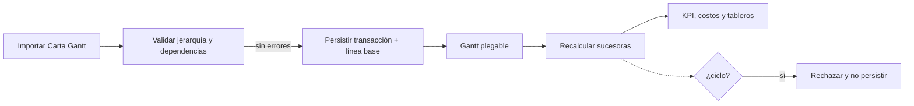

# ADR-007: Carta Gantt como unidad de trabajo y dependencias explícitas

- **Estado:** aceptado
- **Fecha:** 2026-10-25
- **Tarea:** F18 — Matriz de trazabilidad y ADR Gantt

## Contexto

La rúbrica exige una jerarquía etapa → actividad → subactividad y precedencias
FS, SS, FF y SF. El alcance de Trazo también pide que la planificación sea
importable, recalculable y demostrable desde una única vista. Mantener un módulo
EDT separado duplicaría la jerarquía y abriría divergencias entre la EDT y el
cronograma.

## Decisión

- La **Carta Gantt es la unidad de trabajo** y la fuente operativa de la
  jerarquía. Las filas plegables representan etapa, actividad, subactividad e
  hito; las filas superiores consolidan fechas, costo y avance de sus hijas.
- No se implementa un módulo independiente de **EDT/WBS** ni pantallas
  “Importar EDT” o “EDT / WBS”. La decisión de no EDT no elimina la jerarquía:
  la mantiene dentro del Gantt mediante `padre_id`.
- Las dependencias se almacenan como relaciones explícitas con tipo FS, SS, FF o
  SF y desfase en días hábiles. El backend valida referencias y ciclos antes de
  persistir; el recálculo devuelve los elementos afectados y sus valores antes y
  después.
- La línea base representa el plan de comparación; el plan vigente, el avance
  real y la proyección se visualizan juntos sin convertir la línea base en datos
  editables.

## Alternativas consideradas

- **EDT como módulo separado:** descartada por duplicación y riesgo de que una
  modificación no se propague al cronograma.
- **Dependencias implícitas por orden de filas:** descartada porque no expresa
  SS/FF/SF ni desfases y hace ambiguo el diagnóstico de ciclos.
- **Recalcular solo en frontend:** descartada; los cálculos deben ser
  deterministas, persistentes y consistentes para API, tableros y auditoría.

## Consecuencias

**Positivas:** una sola fuente operativa, trazabilidad directa desde una fila a
sus sucesoras, validación transaccional y representación alineada con la demo.

**Costos:** la interfaz debe hacer visible la jerarquía para satisfacer la
rúbrica; quienes esperen una pantalla EDT deben usar filtros, filas agrupadas y
el modelo `padre_id` del Gantt.

## Límites de verificación

- La evidencia automatizada actual cubre motor, importación, API, integridad,
  RBAC y checklist; el detalle está en `docs/matriz-trazabilidad.md`.
- La validación visual de barras, plegado y propagación entre módulos se ejecuta
  con el guion manual de `docs/f18-guion-trazabilidad.md`.
- Docker es el entorno reproducible documentado, pero este ADR no afirma una
  prueba E2E dentro de contenedores: no existe aún una suite browser ni un job
  que levante todo el `docker compose` como test automatizado.
