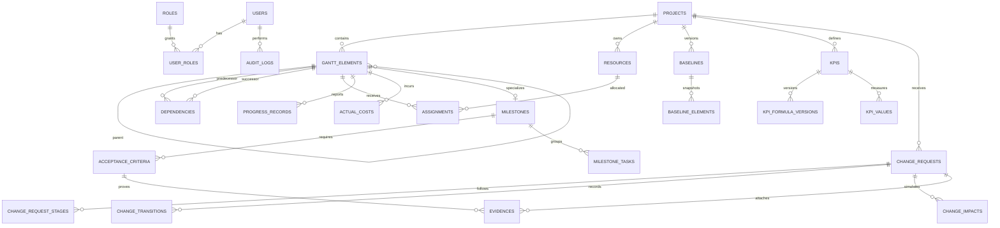

# Modelo de datos F1

La aplicación usa una base PostgreSQL 16 independiente (`trazo_db`). Las
claves primarias son UUID y las fechas de auditoría usan `TIMESTAMP WITH TIME
ZONE`; las fechas del cronograma que no representan una hora son `DATE`.

## Migraciones

Desde `backend/`:

```powershell
alembic upgrade head
alembic downgrade base # solo para una base de desarrollo desechable
```

La URL se toma de `DATABASE_URL` (la URL de `alembic.ini` es únicamente el
valor local por defecto). La migración inicial crea 27 tablas, índices de
búsqueda y enums nativos de PostgreSQL.

## Diagrama ER



### Integridad relevante

- `gantt_elements` usa `parent_id` para la jerarquía y `dependencies` impide
  auto-enlaces; la validación de ciclos y de niveles queda en el servicio de
  dominio porque requiere recorrer el grafo.
- Las FK de asignaciones, calendario y dependencias están indexadas o forman
  parte de índices compuestos para las consultas del Gantt.
- Una línea base conserva una copia de sus elementos en
  `baseline_elements`. El servicio crea el snapshot con `approved_at` nulo y
  lo sella al aprobarlo; desde ese momento un trigger PostgreSQL impide
  insertar, modificar o borrar snapshots. En `baselines` solo puede cambiar
  el estado de ciclo de vida.
- El histórico de avances, costos, valores KPI y transiciones de cambio es
  append-only a nivel de aplicación. La bitácora `audit_logs` conserva antes y
  después en JSONB.
- `evidences` exige exactamente un propietario: criterio de aceptación o
  solicitud de cambio.
